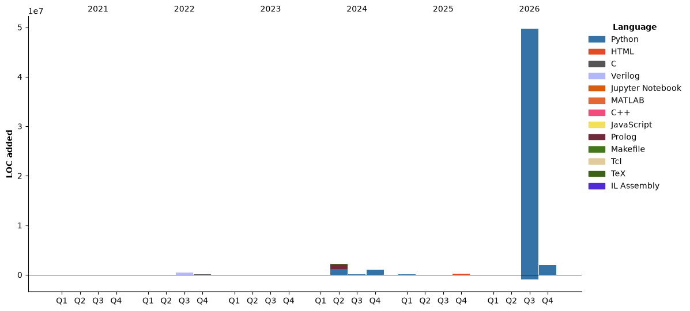

### Welcome 👋

<!--START_SECTION:waka-->


📊 **This Week I Spent My Time On** 

```text
🕑︎ Time Zone: Asia/Hong_Kong

💬 Programming Languages: 
Other                    14 hrs 49 mins      █████████░░░░░░░░░░░░░░░░   36.09 % 
TeX                      13 hrs 25 mins      ████████░░░░░░░░░░░░░░░░░   32.65 % 
Markdown                 8 hrs 57 mins       █████░░░░░░░░░░░░░░░░░░░░   21.79 % 
PowerShell               1 hr 58 mins        █░░░░░░░░░░░░░░░░░░░░░░░░   04.81 % 
Text                     1 hr 34 mins        █░░░░░░░░░░░░░░░░░░░░░░░░   03.85 % 

🔥 Editors: 
Unknown Editor           23 hrs 1 min        ██████████████░░░░░░░░░░░   56.03 % 
Chrome                   7 hrs 56 mins       █████░░░░░░░░░░░░░░░░░░░░   19.31 % 
Notion                   5 hrs 37 mins       ███░░░░░░░░░░░░░░░░░░░░░░   13.68 % 
Cursor                   4 hrs 13 mins       ███░░░░░░░░░░░░░░░░░░░░░░   10.27 % 
Edge                     16 mins             ░░░░░░░░░░░░░░░░░░░░░░░░░   00.66 % 

💻 Operating System: 
Windows                  41 hrs 5 mins       █████████████████████████   100.00 % 
```

🤖 **AI Coding This Week** 

```text
⏱ AI Coding Time: 25 hrs 59 mins (63.24%)

✍️ 83 lines written by AI, 0 lines written by hand (100.0% AI-written)

🔤 944,297 Input Tokens, 10,411 Output Tokens

💵 $0.18 Estimated AI Cost This Week

🧠 59 AI Sessions, 265 AI Prompts

Grok                     87 lines            █████████████████████████   100.00 % 
GPT                      0 lines             ░░░░░░░░░░░░░░░░░░░░░░░░░   00.00 % 

🔎 AI Coding Insights:
🤖 AI-Driven — 100.0% of written lines came from AI
📄 Detailed Prompter — average 743 characters per prompt
🔁 Iterative Prompter — average 4 prompts per session
🚀 High AI Trust — 0.0% of changed lines were hand-edited
```

**I Mostly Code in Python** 

```text
Python                   26 repos            ███████████████░░░░░░░░░░   59.09 % 
TeX                      2 repos             █░░░░░░░░░░░░░░░░░░░░░░░░   04.55 % 
Prolog                   2 repos             █░░░░░░░░░░░░░░░░░░░░░░░░   04.55 % 
HTML                     2 repos             █░░░░░░░░░░░░░░░░░░░░░░░░   04.55 % 
IL Assembly              1 repo              █░░░░░░░░░░░░░░░░░░░░░░░░   02.27 % 
```


**Timeline**




 Last Updated on 03/11/2026 09:52:37 UTC
<!--END_SECTION:waka-->

