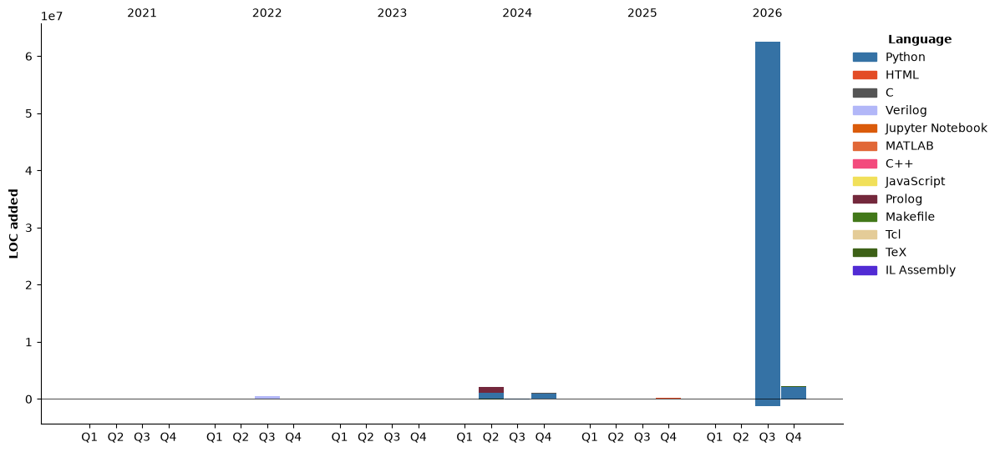

### Welcome 👋

<!--START_SECTION:waka-->


📊 **This Week I Spent My Time On** 

```text
🕑︎ Time Zone: Asia/Hong_Kong

💬 Programming Languages: 
Other                    20 hrs 12 mins      ██████████████░░░░░░░░░░░   56.60 % 
TeX                      8 hrs 17 mins       ██████░░░░░░░░░░░░░░░░░░░   23.21 % 
Text                     3 hrs 9 mins        ██░░░░░░░░░░░░░░░░░░░░░░░   08.86 % 
Markdown                 2 hrs 17 mins       ██░░░░░░░░░░░░░░░░░░░░░░░   06.41 % 
PowerShell               37 mins             ░░░░░░░░░░░░░░░░░░░░░░░░░   01.75 % 

🔥 Editors: 
Unknown Editor           20 hrs 15 mins      ██████████████░░░░░░░░░░░   57.00 % 
Chrome                   7 hrs 33 mins       █████░░░░░░░░░░░░░░░░░░░░   21.26 % 
Cursor                   6 hrs 51 mins       █████░░░░░░░░░░░░░░░░░░░░   19.28 % 
Edge                     42 mins             ░░░░░░░░░░░░░░░░░░░░░░░░░   01.97 % 
MicrosoftWord            7 mins              ░░░░░░░░░░░░░░░░░░░░░░░░░   00.36 % 

💻 Operating System: 
Windows                  35 hrs 31 mins      █████████████████████████   100.00 % 
```

🤖 **AI Coding This Week** 

```text
⏱ AI Coding Time: 18 hrs 37 mins (52.41%)

✍️ 298 lines written by AI, 4 lines written by hand (98.68% AI-written)

🔤 1,239,071 Input Tokens, 29,057 Output Tokens

💵 $5.38 Estimated AI Cost This Week

🧠 63 AI Sessions, 311 AI Prompts

Grok                     301 lines           █████████████████████████   100.00 % 
GPT                      0 lines             ░░░░░░░░░░░░░░░░░░░░░░░░░   00.00 % 

🔎 AI Coding Insights:
🤖 AI-Driven — 98.68% of written lines came from AI
📄 Detailed Prompter — average 655 characters per prompt
🔁 Iterative Prompter — average 5 prompts per session
🚀 High AI Trust — 1.31% of changed lines were hand-edited
```

**I Mostly Code in Python** 

```text
Python                   26 repos            ███████████████░░░░░░░░░░   59.09 % 
TeX                      2 repos             █░░░░░░░░░░░░░░░░░░░░░░░░   04.55 % 
Prolog                   2 repos             █░░░░░░░░░░░░░░░░░░░░░░░░   04.55 % 
HTML                     2 repos             █░░░░░░░░░░░░░░░░░░░░░░░░   04.55 % 
IL Assembly              1 repo              █░░░░░░░░░░░░░░░░░░░░░░░░   02.27 % 
```


**Timeline**




 Last Updated on 20/11/2026 00:54:05 UTC
<!--END_SECTION:waka-->

